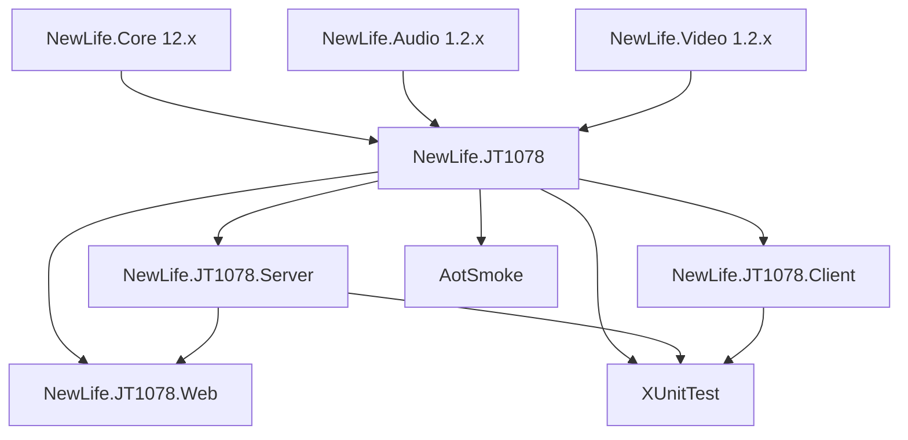

# NewLife.JT1078 架构设计

> 版本：v1.4 | 日期：2026-10-20

本文档描述 NewLife.JT1078 的架构设计、核心接口和数据流。需求定义见[需求文档](需求文档.md)，进度追踪见[功能清单](功能清单.md)。

## 1. 架构概览

### 1.1 分层架构

```
┌─────────────────────────────────────────────┐
│       消息管道层（IMsgHandler 体系）            │
│   FlvHandler · Mp4Handler · HlsHandler       │
│   AacHandler · PcmHandler · WavHandler       │
│   Mp3Handler                                  │
│   格式编码 · IMsgHub 中转 · IMsgUser 订阅      │
│   ───────────────────────────────────────    │
│   IMsgHost → 设备下行信令                      │
├─────────────────────────────────────────────┤
│           服务层（Server）                     │
│   JT1078Server / JT1078Session               │
│   JT1078UdpServer / JT1078UdpSession          │
│   TCP/UDP 监听 · 分包合并 · 会话管理            │
│   DeviceSessionManager · StatusService        │
├─────────────────────────────────────────────┤
│       编解码与封装层（JT1078 核心）               │
│   FlvEncoder / FMp4Encoder                   │
│   H264Decoder · AudioCodecFactory            │
│   RTP → FLV/fMP4 容器转换 · 音视频编解码        │
│   ───────────────────────────────────────    │
│   外部依赖: NewLife.Audio (音频编解码)          │
│              NewLife.Video (视频容器/编解码)    │
├─────────────────────────────────────────────┤
│         协议层（Protocols / Models）            │
│   JTMessage · JTCodec · 消息体模型             │
│   IMsgHandler · IMsgHub · IMsgUser          │
│   RTP 报文解析/构建 · 粘包处理 · 消息序列化       │
└─────────────────────────────────────────────┘
```

### 1.2 项目结构

| 项目 | 类型 | 定位 | 依赖 |
|------|------|------|------|
| **NewLife.JT1078** | NuGet 包 📦 | 核心协议 + 编解码 + FLV/fMP4 转封装 | NewLife.Core, NewLife.Audio, NewLife.Video |
| **NewLife.JT1078.Server** | NuGet 包 📦 | TCP/UDP 服务端 + 消息管道 + DI 构建器 + HLS/MP3 编码 | NewLife.JT1078 |
| **NewLife.JT1078.Web** | 演示应用（不发布） | HTTP/WebSocket 直播端点 + 设备命令 API | NewLife.JT1078.Server |
| **NewLife.JT1078.Client** | 桌面应用（不发布） | Avalonia 测试客户端（直播拉流/录像回放/设备命令/TCP-UDP直连） | NewLife.JT1078 |
| **AotSmoke** | 冒烟工程（不发布） | NativeAOT 发布冒烟：帧编解码 + 模型序列化 + DI 装配 + 多语言查表 | NewLife.JT1078、NewLife.JT1078.Server |
| **XUnitTest** | 测试项目 | 单元/集成测试（146项） | 全部项目 |

### 1.3 命名空间

```
NewLife.JT1078                    — 核心库根命名空间
NewLife.JT1078.Protocols         — 协议层（JTMessage, JTCodec, AVTypes 等）
NewLife.JT1078.H264              — H.264 解析（NALUHeader 来自 NewLife.Video.Codecs，SPS 解析为带边界检查的本地实现）
NewLife.JT1078.Models            — 消息体模型和辅助模型
NewLife.JT1078.Serialization     — BCD 序列化特性
NewLife.JT1078.Flv               — FLV 封装
NewLife.JT1078.FMp4              — fMP4 封装
NewLife.JT1078.Server            — TCP 服务端
```

## 2. 核心接口设计

### 2.1 IAudioCodec — 音频编解码接口

```csharp
public interface IAudioCodec
{
    /// <summary>音频解码为 PCM</summary>
    Int32 ToPcm(ReadOnlySpan<Byte> data, IAudioAttachData state, Span<Byte> pcm);

    /// <summary>PCM 编码为音频格式</summary>
    Int32 FromPcm(ReadOnlySpan<Byte> pcm, IAudioAttachData state, Span<Byte> data);
}
```

**设计要点**：
- 使用 `Span<Byte>` 避免内存分配
- `IAudioAttachData` 传递编解码器状态（如 ADPCM 的 step/index）
- 返回写入/读取的字节数

### 2.2 IMessage — 协议消息接口

JTMessage 继承 NewLife.Core 的 `Message` 基类（实现 `IMessage`/`IDisposable`），获得负载读写（`Payload`/`Body`/`SetBody`/`BindBody`）与方向语义（`Kind`/`Reply`/`OneWay`）；帧格式由 `JTCodec : IMessageCodec` 承担。

```csharp
public class JTMessage : Message, IAccessor
{
    public Byte Version { get; set; }
    // ... RTP 头部字段
}

public class JTCodec : IMessageCodec
{
    ParseResult? TryParse(ReadOnlySequence<Byte> buffer);   // 定界并构造消息
    IOwnerPacket Build(IMessage message);                    // 整帧构建
    IOwnerPacket BuildHeader(IMessage message, Int64 bodyLength); // 头部构建
}
```

**设计要点**：消息为纯数据载体，不感知帧字节；`IStreamSession` 协议模式下由消息泵按 `JTCodec` 定界，头部到齐即交付，负载由帧层绑定。消息在处理器返回后即收尾，跨调用留存须先克隆（`JTMessage.Clone()`）。

JTMessage 同时实现 `IAccessor`，支持标准二进制序列化和自定义字段偏移。

### 2.3 消息管道接口体系

```csharp
// 消息处理接口。每个格式一个实现，瞬态注册
public interface IMsgHandler
{
    IMsgHub Hub { get; set; }
    Task<Int32> EncodeAsync(JTMessage message, IMsgUser[] users);
}

// 消息中枢接口。管理设备连接与用户订阅者之间的数据分发
public interface IMsgHub
{
    String SIM { get; set; }
    Int32 Channel { get; set; }
    Object Device { get; set; }
    Int32 IdleTime { get; set; }
    AudioCodecFactory AudioCodec { get; }

    void Start(String sim, Int32 channel, DataTypes type);
    void Close(String reason);
    Task<Int32> ProduceAsync(JTMessage msg, CancellationToken cancellationToken = default);
    Boolean AddUser(IMsgUser user);
    Boolean RemoveUser(IMsgUser user);
    IMsgUser[] GetUsers();
}

// 消息用户接口。代表一个拉流订阅者（HTTP/WS）
public interface IMsgUser : IDisposable2
{
    Int32 Id { get; }
    String BizCode { get; set; }
    String SIM { get; set; }
    Int32 Channel { get; set; }
    Boolean RequireVideo { get; set; }
    Boolean RequireAudio { get; set; }
    IMsgHub Hub { get; set; }
}

// 消息宿主接口。向终端设备发送下行信令
public interface IMsgHost
{
    Task<Int32> SendJT(AVTypes avtype, DataTypes dataType, IPacket data);
}
```

**设计要点**：
- **IMsgHub** 作为核心中枢，聚合编解码器工厂（AudioCodecFactory）和订阅者管理
- **IMsgHandler** 为每种输出格式（FLV/fMP4/HLS/AAC/PCM/WAV/MP3）的编码器，瞬态注册到 Hub
- **IMsgUser** 表示一个拉流客户端，支持按视频/音频过滤订阅
- **IMsgHost** 提供设备下行信令通道，由 JT1078Session 实现

### 2.4 外部依赖说明

FLV/fMP4 封装和 H264 基础解析能力由 **NewLife.Video** 包提供（含 FLV 容器类型、ISO BMFF Box 类型、NALUHeader 等编解码基础类型），音频编解码能力由 **NewLife.Audio** 包提供（G.711/ADPCM/AAC 编解码器、AudioCodecFactory 等）。JT1078 核心项目仅包含与 RTP 协议强相关的编解码逻辑（H264Decoder/H264NALU 等依赖 JTMessage 的类型）与带边界检查的 SPS 解析器 `H264SpsParser`。

依赖基线：NewLife.Core 12.x、NewLife.Audio 1.2.x、NewLife.Video 1.2.x（均取最新 beta）。Core 12 移除了 `Handler`/`IHandlerContext`/`PacketCodec`，改为 `IMessageCodec`/`MessagePump` 协议模式；本项目已按新架构迁移。

## 3. 数据流

### 3.1 RTP 报文收发流程

```
终端设备 ─TCP─► 协议模式（NetServer.Protocol = JTCodec）
                    │
                    ├─► MessagePump 帧定界
                    │      (头部到齐即交付，负载由帧层绑定)
                    │
                    ▼
               JTMessage（头部字段 + 负载）
                    │
                    ├─► 固定头 16 字节
                    │      魔数01cd/Version/Type+Completed/Sequence/SIM/Channel/
                    │      DataType+PacketFlag
                    │
                    ├─► 条件字段（根据 DataType）
                    │      非透传: +Timestamp(8)
                    │      视频帧: +LastIFrameInterval(2)+LastFrameInterval(2)
                    │
                    ├─► 负载长度 2 字节 + Payload 数据体
                    │      (头部到齐即可交付，流式体由帧层绑定)
                    │
                    └─► 处理器内 Body.ReadAllAsync 读满物化
```

### 3.2 音频解码流程

```
JTMessage (载荷类型=ADPCMA/G711A/G711U)
    │
    ▼
AudioCodecFactory.ToPcm()
    │
    ├─► TrimHI()  剥离海思芯片头（0x00 0x01 0x52 0x00）
    │
    ├─► ADPCMCodec.ToPcm()
    │   ├─► adpcm_decoder()  单采样点解码
    │   └─► 写入16bit PCM
    │
    ├─► G711ACodec.ToPcm()
    │   └─► AlawToLinear[]  查表转换
    │
    └─► G711UCodec.ToPcm()
        └─► Ulaw2linear[]  查表转换
```

### 3.3 H.264 视频解析流程

```
JTMessage (载荷类型=H264, DataType=I/P/B)
    │
    ▼
H264Decoder.ParseNALU()
    │
    ├─► 扫描起始码 00 00 01 / 00 00 00 01
    │
    ├─► 解析 NALUHeader (forbidden/ref/nutype)
    │
    └─► 跳过连续起始码产生的空片段
```

```
H264Decoder.ParseAVFrame()
    │
    ├─► ParseNALU() 获取 NAL 单元列表
    │
    ├─► 遍历查找 SPS (nutype=7) 和 PPS (nutype=8)
    │
    ├─► 解析 SPS 前剥离竞争字节 00 00 03 → 00 00
    │
    ├─► H264SpsParser.TryParse()（带边界检查）
    │   ├─► profile_idc, level_idc
    │   ├─► pic_width_in_mbs, pic_height_in_map_units
    │   └─► 计算实际宽高（含 crop），解析失败不赋值
    │
    └─► 返回 AVFrame (含 SPS/PPS/宽高/Profile/Level)
```

### 3.4 FLV 转封装流程

```
JTMessage RTP 包序列
    │
    ▼
FlvEncoder
    │
    ├─► EncoderFlvHeader()  首次调用，生成 FLV 头部
    │
    ├─► EncoderScriptTag()  首帧，生成 onMetaData
    │   └─► H264Decoder.ParseAVFrame() 获取宽高
    │
    ├─► EncoderVideoTag()
    │   ├─► H264Decoder.ParseNALU() 分割 NAL 单元
    │   ├─► 首帧含 AVCDecoderConfigurationRecord (SPS+PPS)
    │   ├─► NAL 单元长度前缀转换（起始码 → 4字节大端长度）
    │   └─► 封装 FLV Video Tag
    │
    └─► EncoderAudioTag()
        ├─► AudioCodecFactory.ToPcm() 解码为 PCM
        ├─► 封装 FLV Audio Tag
        └─► 首次含 AudioSpecificConfig
```

### 3.5 fMP4 转封装流程

```
JTMessage RTP 包序列
    │
    ▼
FMp4Encoder
    │
    ├─► FtypBox()  ftyp, 品牌=iso6/iso2/avc1/mp41
    │
    ├─► MoovBox()
    │   ├─► mvhd (Movie Header)
    │   ├─► trak → tkhd → mdia → mdhd → hdlr → minf
    │   │   └─► stbl → stsd (avc1 + avcC) → stts → stsc → stsz → stco
    │   └─► mvex → mehd → trex
    │
    ├─► 每组 GOP 生成一对 moof + mdat
    │   ├─► moof → mfhd → traf → tfhd → tfdt → trun
    │   └─► mdat (NAL 长度前缀格式数据)
    │
    └─► (可选)mfra → tfra → mfro
```

### 3.6 HLS 直播流程

HLS 直播将 H.264 视频和 AAC 音频复用为 MPEG-TS 段，通过 M3U8 播放列表索引。

```
JTMessage RTP 包序列
    │
    ▼
MsgHub.ProduceAsync() → 匹配 HlsHandler
    │
    ▼
HlsHandler.EncodeAsync()
    │
    ├─► H264Decoder.ParseAVFrame() 解析视频帧
    ├─► FaacEncoder 将 PCM 编码为 AAC 音频帧
    │
    ▼
TSMuxer (MPEG-TS 复用器)
    │
    ├─► PAT + PMT（段起始 PSI）
    ├─► 视频 PES 包（H.264 NAL 单元，StreamId=0xE0）
    ├─► 音频 PES 包（AAC 帧，StreamId=0xC0）
    └─► 188 字节 TS 包（SyncByte=0x47）
    │
    ▼
HlsSegmentCache
    │
    ├─► 每个设备通道维护滑动窗口（最多 20 个段）
    ├─► 段时长约 2 秒
    └─► HTTP 端点 `/hls.m3u8`（播放列表）+ `/hls.ts?seq=N`（TS 段）
```

**组件说明**：
- **TSMuxer**：内部复用器，将 H.264 NAL 和 AAC ADTS 复用为 MPEG-TS 传输流包
- **HlsSegmentCache**：每个设备通道的 TS 段环形缓冲区，线程安全并发读写
- **M3U8Writer**：生成 `#EXTM3U` 播放列表，包含 `#EXTINF` 段信息和 URL

### 3.7 MP3 音频编码流程

纯 C# 简易 MP3 编码器，无需外部原生库依赖。

```
JTMessage RTP 包序列（音频帧）
    │
    ▼
MsgHub.ProduceAsync() → 匹配 Mp3Handler
    │
    ▼
Mp3Handler.EncodeAsync()
    │
    ├─► AudioCodecFactory.ToPcm() 解码为 PCM
    │
    ▼
Mp3Encoder (纯 C# 简易 MP3 编码器)
    │
    ├─► MPEG-2.5 Layer III，8kHz 单声道
    ├─► 每帧 576 样本，MDCT + 量化
    ├─► 固定比特率 64kbps
    └─► 帧头(4) + 侧信息(17) + 主数据
    │
    ▼
HTTP 端点 `/live.mp3` 推流
```

## 4. 关键设计决策

### 4.1 Span\<T\> 零分配策略

编解码路径使用 `ReadOnlySpan<Byte>` / `Span<Byte>` 避免数组分配。音频编解码器直接操作 `Span`，H.264 SPS 解析使用带边界检查的 `ref struct` 位读取器（`H264SpsParser`）；NewLife.Video 的 `ExpGolombReader` 在数据不足时会无限递归，不能直接用于网络输入。

### 4.2 ArrayPool 缓冲区池化

FLV 和 FMp4 编码器使用 `ArrayPool<Byte>.Shared` 租用临时缓冲区，而非每次分配新数组。封装为 `FlvArrayPool` / `FMp4ArrayPool`。

### 4.3 JTCodec 帧定界

服务端在 `NetServer.Protocol` 设置 `JTCodec` 即启用协议模式，每个 TCP 会话由消息泵独立定界。`JTCodec.TryParse` 读取 16 字节固定头后按数据类型计算完整头长（透传帧 18 字节、视频帧 30 字节、音频帧 26 字节），返回 `HeaderSize` 与 `BodyLength`，魔数不匹配或负载超限标记 `Invalid` 并断开连接。`JTMessage.GetLength2()` 保留为历史长度探测入口。

帧未完整时消息体为流式读取器，`JT1078Session` 在处理器返回前调用 `Body.ReadAllAsync()` 读满物化，保证分包合并、事件订阅与消息中枢拿到完整负载。

### 4.4 分包合并策略

RTP 分包（首包/中间包/末包）在同一 TCP 会话内顺序到达。服务端按 `{SIM}-{Channel}-{AVType}` 作为 Key 缓存首包，收到末包后拼接完整帧。协议模式下消息在处理器返回后即收尾，缓存与异步分发前均先克隆消息（`JTMessage.Clone()`）实现负载物化。末包拼接完成后将链式负载合并为连续缓冲区，供 `GetSpan()` 解码路径（H264、音频 ToPcm）完整读取。

### 4.5 自定义序列化

消息体模型（T9xxx/T1xxx）为独立的可序列化 POCO，使用 `[MessageKind]` 特性关联消息类型。BCD 编码字段使用 `[BCDString]` / `[BCDTime]` 特性实现透明序列化。

## 5. 依赖关系



核心库依赖 `NewLife.Core`、`NewLife.Audio`、`NewLife.Video`，无其他第三方依赖。Server/Web/Client 依赖核心库。

> 注：`NewLife.JT1078.Flv` 和 `NewLife.JT1078.FMp4` 已合并入核心库，不再作为独立项目/包发布。

## 6. 兼容性与发布基线

| 项目 | 目标框架 | AOT | 多语言 |
|------|---------|-----|--------|
| NewLife.JT1078 | net461;netstandard2.0;netstandard2.1;net8.0;net10.0 | net8.0+ 启用分析器，冒烟通过 | 10 种语言词表 |
| NewLife.JT1078.Server | netstandard2.0;netstandard2.1;net6.0;net8.0;net10.0 | net8.0+ 启用分析器 | 10 种语言词表 |

- **NativeAOT**：net8.0+ 目标常驻 `<IsAotCompatible>true</IsAotCompatible>`，构建期零 IL 告警；`AotSmoke` 在 CI 以 `PublishAot=true` 发布原生镜像并运行协议编解码、模型序列化与多语言查表。
- **强名称签名**：Core 与 Server 使用 `Doc/newlife.snk` 签名，`PublicKeyToken=8343210f0b524456`，与 NewLife 生态一致；程序集版本按日期固定，避免绑定漂移。
- **运行时多语言**：采用 NewLife.Core 的 `Locales/*.yml` + 源生成器机制，英文为源文与兜底；异常/日志走 `Localization.Translate` / `InfoPrefixed`，词表 Deflate 压缩内嵌，单 DLL、AOT 安全。
- **发布**：`NewLife.JT1078` 与 `NewLife.JT1078.Server` 由 `publish*.yml` 打包发布；`AotSmoke`/Web/Client/测试项目 `IsPackable=false`。

## 7. 性能考量

| 路径 | 策略 | 目标 |
|------|------|------|
| RTP 解析 | Span\<T\> + 大端直接读取 | 单包 < 1μs |
| 音频解码 | 查表法 + Span | 单帧 < 100μs |
| H.264 解析 | ref struct + 内存扫描 | 单帧 < 500μs |
| FLV 编码 | ArrayPool 池化 | 单包 < 100μs |
| fMP4 编码 | 预计算 Box Size + 回填 | 单 GOP < 1ms |

## 8. 集群命令下发架构

### 8.1 概述

多实例部署场景下，应用层需要向指定终端设备发送下行信令（如远程录像回放请求、实时音视频传输控制等）。由于设备可能连接在任意一台服务器上，命令下发必须具备**集群广播**能力。

### 8.2 DeviceSessionManager — 设备命令总线

```
┌───────────────────────────────────────────────────────────┐
│                    App / API 层                            │
│   CommandController.Send() → DeviceManager.PublishAsync()  │
└───────────────────────┬───────────────────────────────────┘
                        │
                        ▼
┌───────────────────────────────────────────────────────────┐
│                DeviceSessionManager                        │
│                                                           │
│  ┌─────────────┐    ┌──────────────────────────────────┐  │
│  │ 本地会话字典  │───→│ 查找会话 → 找到 → SendJT()    │  │
│  │ (SIM_Channel)│    └──────────────────────────────────┘  │
│  └─────────────┘           │ 未找到                         │
│                            ▼                               │
│  ┌──────────────────────────────────────────────────┐  │
│  │ IEventBus<String>                               │  │
│  │   ├─ 单机: EventBus (内存)                      │  │
│  │   └─ 集群: Redis EventBus (通过 ICacheProvider) │  │
│  │  PublishAsync → 广播到所有实例                   │  │
│  └──────────────────────────────────────────────────┘  │
│                            │                             │
│                            ▼                             │
│  ┌──────────────────────────────────────────────────┐  │
│  │ 各实例收到 OnMessage → 查找本地会话               │  │
│  │ 命中 → SendJT(avtype, dataType, payload)         │  │
│  │ 未命中 → 忽略（说明设备不在本实例）               │  │
│  └──────────────────────────────────────────────────┘  │
└───────────────────────────────────────────────────────────┘
```

### 8.3 事件总线模式

| 模式 | 总线类型 | 集群支持 | 适用场景 |
|------|---------|---------|---------|
| 单机 | `EventBus<String>`（内存） | ❌ 仅进程内 | 开发测试、单实例部署 |
| 集群 | Redis EventBus（通过 ICacheProvider） | ✅ 跨进程 | 生产环境多实例部署 |

消息格式：`SIM_Channel#AVType|DataType|HexPayload`

### 8.4 工作流程

1. **应用层调用**：`POST /Command/Send` 发送命令（SIM, Channel, AVType, DataType, Hex负载）
2. **DeviceSessionManager.PublishAsync()**：
   - 查找本地会话字典（Key = `{SIM}_{Channel}`）
   - **本地命中**：直接调用 `JT1078Session.SendJT()` 发送
   - **本地未命中**：通过事件总线广播到集群所有实例
3. **各实例 OnMessage 处理**：
   - 解析消息为 SIM_Channel 和设备命令
   - 查找本地会话字典
   - 命中时通过 `SendJT()` 转发给设备

### 8.5 接口定义

```csharp
public class DeviceSessionManager : DisposeBase
{
    // 注册/注销设备会话
    void Register(String key, JT1078Session session);
    void Unregister(String key);

    // 命令下发（同步 + 异步）
    Boolean Publish(String sim, Int32 channel, AVTypes avtype, DataTypes dataType, IPacket payload);
    Task<Boolean> PublishAsync(String sim, Int32 channel, AVTypes avtype, DataTypes dataType, IPacket payload, CancellationToken cancellationToken);

    // 查询
    JT1078Session GetSession(String key);
    JT1078Session[] GetSessions();
    Boolean Contains(String key);
}
```

### 8.6 REST API

| 方法 | 路径 | 说明 |
|------|------|------|
| POST | `/Command/Send` | 发送下行信令（同步），返回 success + message |
| POST | `/Command/SendAsync` | 发送下行信令（异步），CancellationToken 支持 |
| GET | `/Command/Devices` | 查询本地已连接的设备列表（含 TCP/UDP 类型） |

### 8.7 初始化集成

服务端启动时自动初始化：

```csharp
// JT1078Server.OnStart()
DeviceManager ??= new DeviceSessionManager(ServiceProvider);
DeviceManager.Init();
```

在 ASP.NET Core 中可通过 `ICacheProvider`（由 Stardust/Redis 提供）自动切换到集群模式。

`JT1078HostedService` 从 DI 解析 `JT1078Server`、`JT1078UdpServer` 与 `DeviceSessionManager` 单例并注入后再启动，确保 `CommandController` 与运行中的服务端共享同一设备会话表；`JT1078Server` 显式仅监听 TCP，UDP 由独立服务端承载以避免端口冲突。


