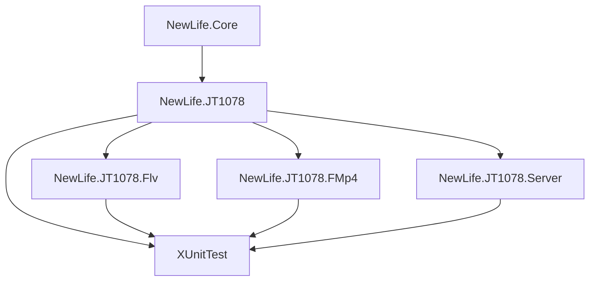

# NewLife.JT1078 架构设计

> 版本：v1.0 | 日期：2026-07-12

本文档描述 NewLife.JT1078 的架构设计、核心接口和数据流。需求定义见[需求文档](需求文档.md)，进度追踪见[功能清单](功能清单.md)。

## 1. 架构概览

### 1.1 分层架构

```
┌─────────────────────────────────────────────┐
│           服务层（Server）                     │
│   JT1078Server / JT1078Session               │
│   TCP 监听 · 分包合并 · 会话管理                │
├─────────────────────────────────────────────┤
│         封装层（Flv / FMp4）                   │
│   FlvEncoder / FMp4Encoder                   │
│   RTP → FLV/ fMP4 容器转换                    │
├─────────────────────────────────────────────┤
│       编解码层（Audio / H264）                  │
│   G711A/U · ADPCM · H264Decoder              │
│   音频编解码 · 视频NAL解析                      │
├─────────────────────────────────────────────┤
│         协议层（Protocols / Models）            │
│   JTMessage · JTCodec · 消息体模型             │
│   RTP 报文解析/构建 · 粘包处理 · 消息序列化       │
└─────────────────────────────────────────────┘
```

### 1.2 项目结构

| 项目 | 类型 | 定位 | 依赖 |
|------|------|------|------|
| **NewLife.JT1078** | NuGet 包 | 核心协议 + 编解码 | NewLife.Core |
| **NewLife.JT1078.Flv** | NuGet 包 | FLV 转封装 | NewLife.JT1078 |
| **NewLife.JT1078.FMp4** | NuGet 包 | fMP4 转封装 | NewLife.JT1078 |
| **NewLife.JT1078.Server** | NuGet 包 | TCP 服务端 | NewLife.JT1078 |
| **XUnitTest** | 测试 | 单元/集成测试 | 全部项目 |

### 1.3 命名空间

```
NewLife.JT1078                    — 核心库根命名空间
NewLife.JT1078.Protocols         — 协议层（JTMessage, JTCodec, AVTypes 等）
NewLife.JT1078.Audio             — 音频编解码
NewLife.JT1078.H264              — H.264 解析
NewLife.JT1078.Models            — 消息体模型和辅助模型
NewLife.JT1078.Serialization     — BCD 序列化特性
NewLife.JT1078.Flv               — FLV 封装
NewLife.JT1078.Flv.Enums         — FLV 枚举
NewLife.JT1078.Flv.Metadata      — AMF3 元数据
NewLife.JT1078.Flv.MessagePack   — FLV 二进制写入器
NewLife.JT1078.FMp4              — fMP4 封装
NewLife.JT1078.FMp4.Boxs         — MP4 Box 类型
NewLife.JT1078.FMp4.Samples      — Sample Entry 类型
NewLife.JT1078.FMp4.MessagePack  — fMP4 二进制读写器
NewLife.JT1078.Server            — TCP 服务端
```

## 2. 核心接口设计

### 2.1 IAudioCodec — 音频编解码接口

```csharp
public interface IAudioCodec
{
    /// <summary>音频解码为 PCM</summary>
    Int32 ToPcm(ReadOnlySpan<Byte> data, IAudioAttachData state, Span<Byte> pcm);

    /// <summary>PCM 编码为音频格式</summary>
    Int32 FromPcm(ReadOnlySpan<Byte> pcm, IAudioAttachData state, Span<Byte> data);
}
```

**设计要点**：
- 使用 `Span<Byte>` 避免内存分配
- `IAudioAttachData` 传递编解码器状态（如 ADPCM 的 step/index）
- 返回写入/读取的字节数

### 2.2 IMessage — 协议消息接口

```csharp
public interface IMessage
{
    Boolean Reply { get; set; }
    Int32 Seq { get; set; }
    Int32 Serial { get; set; }
    Int32 Count { get; set; }
}
```

JTMessage 实现 `IMessage` 和 `IAccessor`，支持标准二进制序列化和自定义字段偏移。

## 3. 数据流

### 3.1 RTP 报文收发流程

```
终端设备 ─TCP─► JTCodec.Read()
                    │
                    ├─► PacketCodec 粘包处理
                    │      (每连接独立解码器，MaxCache=10240)
                    │
                    ▼
               JTMessage.Read(Stream)
                    │
                    ├─► 解析固定头部（17字节）
                    │      Version/Type/Completed/Sequence/SIM/Channel/
                    │      DataType/PacketFlag/Timestamp/
                    │      LastIFrameInterval/LastFrameInterval
                    │
                    ├─► 解析条件字段（根据 DataType）
                    │      I帧: +Timestamp +LastIFrameInterval +LastFrameInterval
                    │      P帧: +LastFrameInterval
                    │      音频: 无额外字段
                    │
                    └─► 读取 Payload 数据体
```

### 3.2 音频解码流程

```
JTMessage (载荷类型=ADPCMA/G711A/G711U)
    │
    ▼
AudioCodecFactory.ToPcm()
    │
    ├─► TrimHI()  剥离海思芯片头（0x00 0x01 0x52 0x00）
    │
    ├─► ADPCMCodec.ToPcm()
    │   ├─► adpcm_decoder()  单采样点解码
    │   └─► 写入16bit PCM
    │
    ├─► G711ACodec.ToPcm()
    │   └─► AlawToLinear[]  查表转换
    │
    └─► G711UCodec.ToPcm()
        └─► Ulaw2linear[]  查表转换
```

### 3.3 H.264 视频解析流程

```
JTMessage (载荷类型=H264, DataType=I/P/B)
    │
    ▼
H264Decoder.ParseNALU()
    │
    ├─► 扫描起始码 00 00 01 / 00 00 00 01
    │
    ├─► 解析 NALUHeader (forbidden/ref/nutype)
    │
    └─► 剥离竞争字节 00 00 03 → 00 00
```

```
H264Decoder.ParseAVFrame()
    │
    ├─► ParseNALU() 获取 NAL 单元列表
    │
    ├─► 遍历查找 SPS (nutype=7) 和 PPS (nutype=8)
    │
    ├─► ExpGolombReader.ReadSPS()
    │   ├─► profile_idc, level_idc
    │   ├─► pic_width_in_mbs, pic_height_in_map_units
    │   └─► 计算实际宽高（含 crop）
    │
    └─► 返回 AVFrame (含 SPS/PPS/宽高/Profile/Level)
```

### 3.4 FLV 转封装流程

```
JTMessage RTP 包序列
    │
    ▼
FlvEncoder
    │
    ├─► EncoderFlvHeader()  首次调用，生成 FLV 头部
    │
    ├─► EncoderScriptTag()  首帧，生成 onMetaData
    │   └─► H264Decoder.ParseAVFrame() 获取宽高
    │
    ├─► EncoderVideoTag()
    │   ├─► H264Decoder.ParseNALU() 分割 NAL 单元
    │   ├─► 首帧含 AVCDecoderConfigurationRecord (SPS+PPS)
    │   ├─► NAL 单元长度前缀转换（起始码 → 4字节大端长度）
    │   └─► 封装 FLV Video Tag
    │
    └─► EncoderAudioTag()
        ├─► AudioCodecFactory.ToPcm() 解码为 PCM
        ├─► 封装 FLV Audio Tag
        └─► 首次含 AudioSpecificConfig
```

### 3.5 fMP4 转封装流程

```
JTMessage RTP 包序列
    │
    ▼
FMp4Encoder
    │
    ├─► FtypBox()  ftyp, 品牌=iso6/iso2/avc1/mp41
    │
    ├─► MoovBox()
    │   ├─► mvhd (Movie Header)
    │   ├─► trak → tkhd → mdia → mdhd → hdlr → minf
    │   │   └─► stbl → stsd (avc1 + avcC) → stts → stsc → stsz → stco
    │   └─► mvex → mehd → trex
    │
    ├─► 每组 GOP 生成一对 moof + mdat
    │   ├─► moof → mfhd → traf → tfhd → tfdt → trun
    │   └─► mdat (NAL 长度前缀格式数据)
    │
    └─► (可选)mfra → tfra → mfro
```

## 4. 关键设计决策

### 4.1 Span\<T\> 零分配策略

编解码路径使用 `ReadOnlySpan<Byte>` / `Span<Byte>` 避免数组分配。音频编解码器直接操作 `Span`，H.264 解析器使用 `ref struct` 的 `ExpGolombReader`。

### 4.2 ArrayPool 缓冲区池化

FLV 和 FMp4 编码器使用 `ArrayPool<Byte>.Shared` 租用临时缓冲区，而非每次分配新数组。封装为 `FlvArrayPool` / `FMp4ArrayPool`。

### 4.3 PacketCodec 粘包处理

每个 TCP 连接独立维护一个 `PacketCodec` 实例。JTCodec 继承 `Handler`，在 `Read`/`Write` 中调用编解码器。JTMessage 的 `GetLength()` 通过头部信息计算完整报文长度。

### 4.4 分包合并策略

RTP 分包（首包/中间包/末包）在同一 TCP 会话内顺序到达。服务端按 `{SessionId}-{AVType}` 作为 Key 缓存中间包，收到末包后拼接完整帧。

### 4.5 自定义序列化

消息体模型（T9xxx/T1xxx）继承 `IMessage`，使用 `[MessageKind]` 特性关联消息类型。BCD 编码字段使用 `[BCDString]` / `[BCDTime]` 特性实现透明序列化。

## 5. 依赖关系



核心库仅依赖 `NewLife.Core`，无其他第三方依赖。封装层和服务端依赖核心库。

## 6. 性能考量

| 路径 | 策略 | 目标 |
|------|------|------|
| RTP 解析 | Span\<T\> + 大端直接读取 | 单包 < 1μs |
| 音频解码 | 查表法 + Span | 单帧 < 100μs |
| H.264 解析 | ref struct + 内存扫描 | 单帧 < 500μs |
| FLV 编码 | ArrayPool 池化 | 单包 < 100μs |
| fMP4 编码 | 预计算 Box Size + 回填 | 单 GOP < 1ms |

## 7. 集群命令下发架构

### 7.1 概述

多实例部署场景下，应用层需要向指定终端设备发送下行信令（如远程录像回放请求、实时音视频传输控制等）。由于设备可能连接在任意一台服务器上，命令下发必须具备**集群广播**能力。

### 7.2 DeviceSessionManager — 设备命令总线

```
┌───────────────────────────────────────────────────────────┐
│                    App / API 层                            │
│   CommandController.Send() → DeviceManager.PublishAsync()  │
└───────────────────────┬───────────────────────────────────┘
                        │
                        ▼
┌───────────────────────────────────────────────────────────┐
│                DeviceSessionManager                        │
│                                                           │
│  ┌─────────────┐    ┌──────────────────────────────────┐  │
│  │ 本地会话字典  │───→│ 查找会话 → 找到 → SendJT()    │  │
│  │ (SIM_Channel)│    └──────────────────────────────────┘  │
│  └─────────────┘           │ 未找到                         │
│                            ▼                               │
│  ┌──────────────────────────────────────────────────┐  │
│  │ IEventBus<String>                               │  │
│  │   ├─ 单机: EventBus (内存)                      │  │
│  │   └─ 集群: Redis EventBus (通过 ICacheProvider) │  │
│  │  PublishAsync → 广播到所有实例                   │  │
│  └──────────────────────────────────────────────────┘  │
│                            │                             │
│                            ▼                             │
│  ┌──────────────────────────────────────────────────┐  │
│  │ 各实例收到 OnMessage → 查找本地会话               │  │
│  │ 命中 → SendJT(avtype, dataType, payload)         │  │
│  │ 未命中 → 忽略（说明设备不在本实例）               │  │
│  └──────────────────────────────────────────────────┘  │
└───────────────────────────────────────────────────────────┘
```

### 7.3 事件总线模式

| 模式 | 总线类型 | 集群支持 | 适用场景 |
|------|---------|---------|---------|
| 单机 | `EventBus<String>`（内存） | ❌ 仅进程内 | 开发测试、单实例部署 |
| 集群 | Redis EventBus（通过 ICacheProvider） | ✅ 跨进程 | 生产环境多实例部署 |

消息格式：`SIM_Channel#AVType|DataType|HexPayload`

### 7.4 工作流程

1. **应用层调用**：`POST /Command/Send` 发送命令（SIM, Channel, AVType, DataType, Hex负载）
2. **DeviceSessionManager.PublishAsync()**：
   - 查找本地会话字典（Key = `{SIM}_{Channel}`）
   - **本地命中**：直接调用 `JT1078Session.SendJT()` 发送
   - **本地未命中**：通过事件总线广播到集群所有实例
3. **各实例 OnMessage 处理**：
   - 解析消息为 SIM_Channel 和设备命令
   - 查找本地会话字典
   - 命中时通过 `SendJT()` 转发给设备

### 7.5 接口定义

```csharp
public class DeviceSessionManager : DisposeBase
{
    // 注册/注销设备会话
    void Register(String key, JT1078Session session);
    void Unregister(String key);

    // 命令下发（同步 + 异步）
    Boolean Publish(String sim, Int32 channel, AVTypes avtype, DataTypes dataType, IPacket payload);
    Task<Boolean> PublishAsync(String sim, Int32 channel, AVTypes avtype, DataTypes dataType, IPacket payload, CancellationToken cancellationToken);

    // 查询
    JT1078Session GetSession(String key);
    JT1078Session[] GetSessions();
    Boolean Contains(String key);
}
```

### 7.6 REST API

| 方法 | 路径 | 说明 |
|------|------|------|
| POST | `/Command/Send` | 发送下行信令（同步） |
| POST | `/Command/SendAsync` | 发送下行信令（异步） |
| GET | `/Command/Devices` | 查询本地已连接的设备列表 |

### 7.7 初始化集成

服务端启动时自动初始化：

```csharp
// JT1078Server.OnStart()
DeviceManager ??= new DeviceSessionManager(ServiceProvider);
DeviceManager.Init();
```

在 ASP.NET Core 中可通过 `ICacheProvider`（由 Stardust/Redis 提供）自动切换到集群模式。

